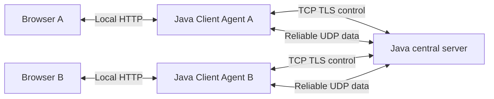

# System architecture

Owner: Member 2. Status: accepted team baseline; implementation pending.

## Components

The server is a single process with modules, not microservices. Each participant has a local Java agent that owns sockets, keys and file handles. The browser renders state and submits commands. Multiple agents on one machine use separate HTTP ports and runtime directories.

## Layer boundaries

1. UI: login, presence, conversations, offers, progress and errors.
2. Application: authenticated sessions, routing, chat receipts, transfer lifecycle.
3. Protocol/transport: serialization, encryption boundaries, UDP reliability, stream ordering, flow control and congestion feedback.

Shared packages do not depend on UI or concrete server/client application packages. Security does not own routing; file service does not own UDP ACKs; congestion control does not write sockets. See [module contracts](module-interfaces.md).

## Traffic and lifecycle

TCP/TLS establishes identity and session/key material. An authenticated UDP endpoint-binding exchange must complete before accepting normal session traffic. UDP carries chat, file messages, presence and heartbeats. Global chat is application-layer fan-out at the server, not reliance on LAN broadcast. Configure the server address in the baseline; automatic LAN server discovery is not required for the first release.

The server validates the session and derives sender identity. Direct chat is forwarded only to the authorized recipient. Transfer IDs bind to a sender/recipient pair; the server relays with bounded buffers and propagates backpressure. It does not accumulate a complete file in memory.

## Reliability and scheduling

Use separate global-chat, direct-conversation and file streams. A missing segment can block ordered delivery within its stream, but cannot impose a global ordering dependency on other streams. Selective acknowledgment avoids resending already received data. Congestion control/pacing applies to aggregate traffic to a peer; receiver credit separately protects buffers.

Control/chat receive priority with a nonzero opportunity for file progress. ACK handling must bypass application ordering. Limits are required for pending sends, reassembly, relay, events, uploads and active transfers.

## Security and trust

TLS certificate and server identity validation stay enabled. UDP uses AES-GCM with directional keys, authenticated headers, fresh packet numbers for every send, and replay checks. Keys are never sent to the browser or logged. Because the server decrypts messages, encryption is client–server, not end-to-end.

The local HTTP server binds to loopback, validates Host/Origin as applicable, and requires an agent-local token for APIs. Static files are restricted to packaged UI assets; uploads/downloads use opaque handles and safe directories, never arbitrary browser-supplied filesystem paths.

## Failure behavior and scope

Heartbeat expiry marks a session offline and releases its resources. Reconnect creates a new session/key context and fails outstanding operations; automatic transfer resume is excluded. Temporary files are cleaned after cancellation/failure. A sender completes a file only after the recipient verifies size/hash and returns `FILE_COMPLETE`.

No multi-server cluster, direct P2P transfer, durable chat history, or read receipts are included. Instructor clarifications remain tracked in [decisions](decisions.md).
