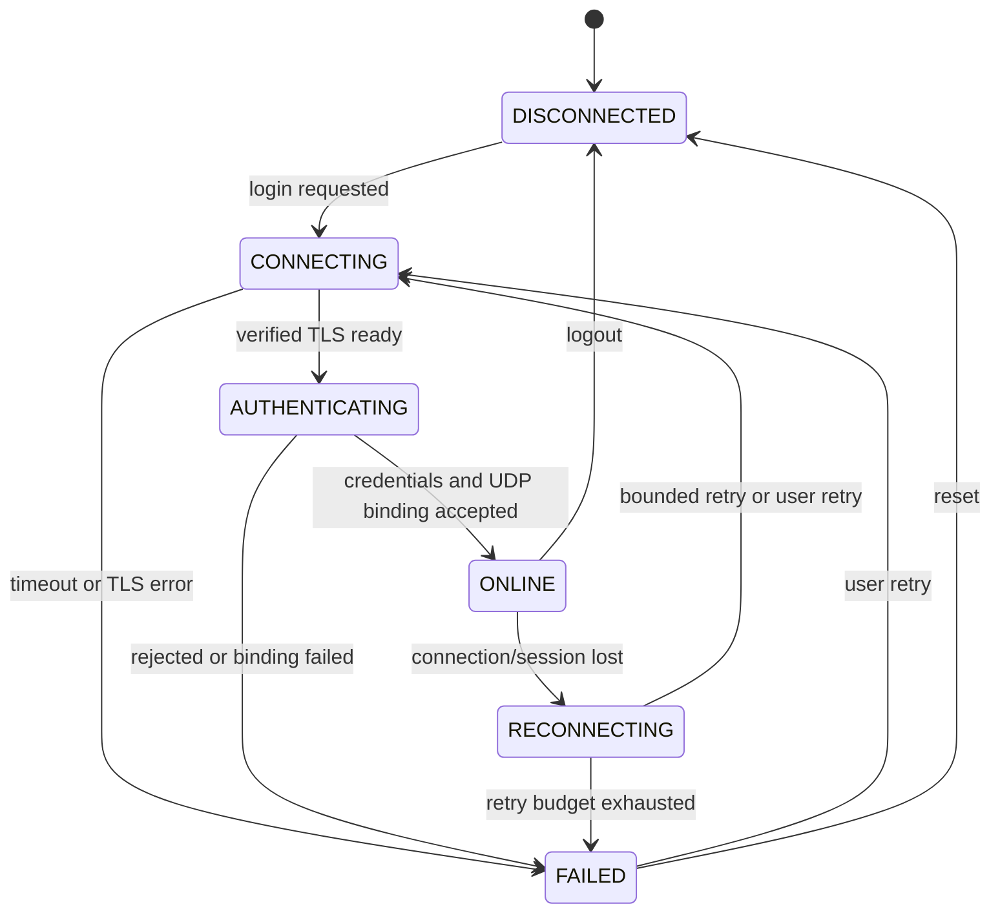
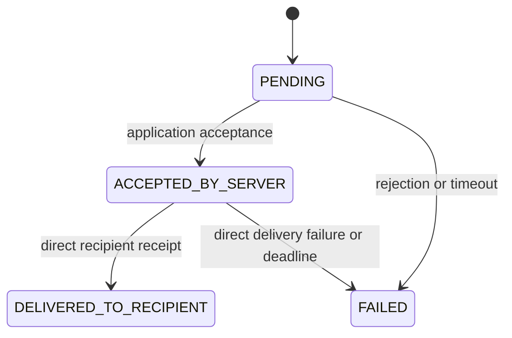
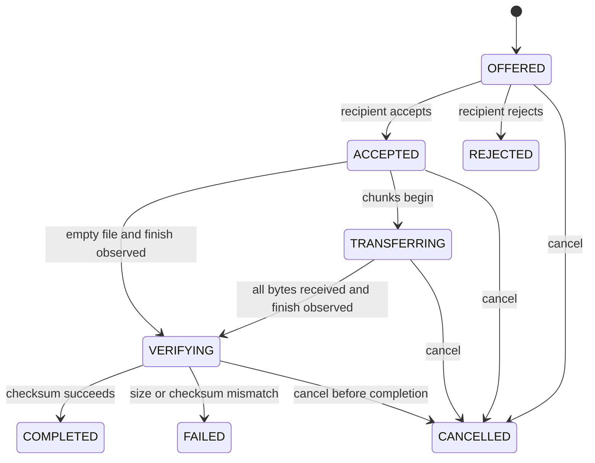

# State machines

Owners: Members 1–4. These diagrams capture agreed application behavior; detailed transport sub-states follow the final wire specification.

## Client connection

From any active state, logout/stop cancels work and closes resources. Going offline fails pending sends/transfers once. Reconnection uses a fresh session and key context; it does not silently retry old file transfers. Members 2/3 must specify retry budgets and how fresh authentication is obtained without persisting plaintext passwords.

## Chat status

`PENDING` is local presentation state, not a network receipt value. Global messages stop at server acceptance in the baseline. Direct-message completion is not proof of reading. Ignore duplicate receipts and prevent a late receipt from incorrectly regressing a terminal state; owners must define timeout-versus-late-receipt precedence before implementation.

## File transfer

Every nonterminal state may transition to `FAILED` on session loss, I/O error or deadline. `COMPLETED`, `FAILED`, `REJECTED`, and `CANCELLED` are terminal for that transfer ID. Retrying creates a new transfer ID.

The diagram primarily describes the receiving side. The sender has a separate local snapshot and may only enter `COMPLETED` after authenticated `FILE_COMPLETE` from the authorized recipient via the server. A sender may remain at 100% byte progress while waiting for confirmation; it must not claim recipient verification has begun unless that information has actually been received.

Cancellation and duplicate control messages are idempotent. Handle cancel/completion races by serialized state transitions, and never delete an already finalized user download as a delayed cancellation side effect.
